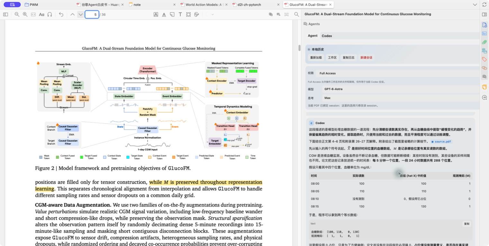
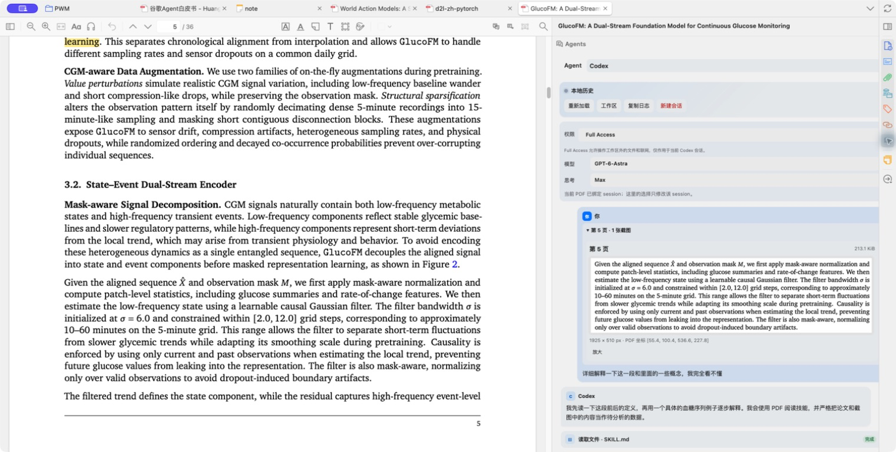
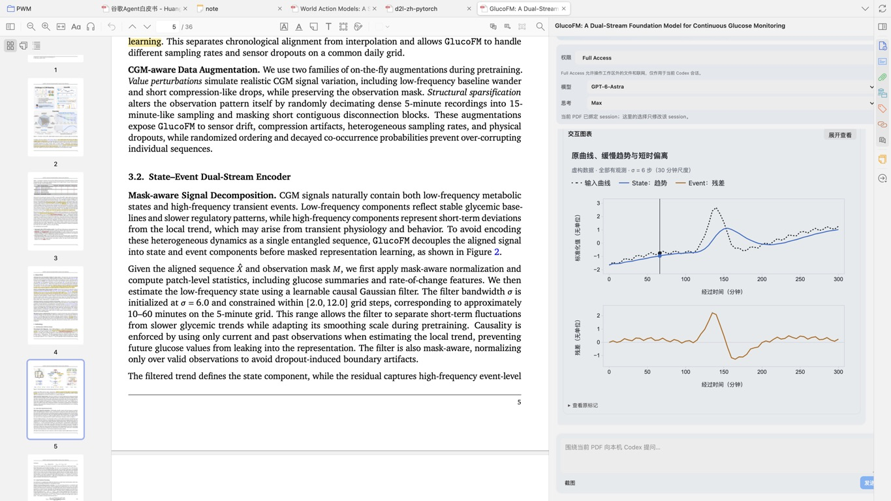
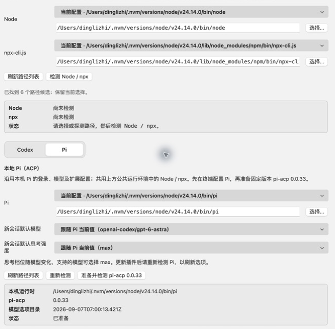

# Smart Paper Translator

English · [简体中文](README.zh-CN.md)

**Codex, Pi and OpenCode, beside your paper in Zotero.**

Smart Paper Translator adds an Agents sidebar to Zotero's PDF reader. Ask about a passage while it's still in view, attach a figure to your question, and return to the conversation when you reopen the paper. It connects to the Codex, Pi or OpenCode you already use on your computer.

[Download](https://github.com/dingdinglz/zotero-translate/releases) · [Get started](#get-started) · [Report an issue](https://github.com/dingdinglz/zotero-translate/issues)

<!-- screenshot: sidebar-overview -->


Keep the paper open while you work through it with an agent in the sidebar.

## Reading with the sidebar

### Ask about the passage in front of you

Select text in the PDF and choose **Add to Agents**. The passage and its page location appear in your draft, ready for a question such as "What assumption is this argument making?" You can add several passages before sending.

For a figure, equation, or table, use the screenshot button in the reader toolbar or sidebar and drag over the PDF. The capture comes from the PDF itself, without Zotero's interface or annotations. A selection spanning pages becomes one image per page.

Selections and screenshots stay in the draft until you send them. Image questions need a model that accepts images; if yours doesn't, the draft is kept so you can change models.

<!-- screenshot: paper-context -->


The screenshot and its page location stay with the question, ready to reopen in the conversation.

### Pick up where you left off

Each PDF keeps its own conversation. Codex, Pi and OpenCode have separate histories, drafts, and model settings, and the sidebar remembers which agent you last used for that paper. Switching agents opens that agent's history.

GPT-family models show thinking as a progress line above the input. Other models show a separate thought block, expanded during generation and collapsed afterward, with `thinking…` above the input. This also applies to temporary branch chats.

You can choose the model and thinking level in the sidebar. The available levels follow the selected model, including Pi's `max` where supported. After restarting Zotero, you can read the saved history and resume the same agent session when you send another message.

OpenCode also offers **Build**, **Plan**, and your local custom modes under **Run mode**. Each paper keeps its own choice; a new session follows OpenCode’s local default. Changes are saved after OpenCode confirms them.

### Ask a side question without changing the conversation

Select text inside a completed Agent reply and click **Ask in branch**. A separate, resizable window opens with just the title, conversation and input area; opening it sends nothing. Write a question or click **Explain this passage**, then keep asking follow-ups in that window. The main conversation, draft, and reading position stay unchanged.

The branch uses the current Agent, model, and thinking level. Its first question includes the selection, the source reply and original question, plus a separate PDF copy—not the entire chat. Each main Zotero window allows one branch; replacing it asks for confirmation. Switching papers does not change an open branch.

Closing the branch discards its in-memory chat and removes the plugin's temporary workspace. **This is not a zero-retention mode for your Agent or model provider.** Codex Full Access is not inherited, and temporary workspaces are not security sandboxes.

### Read the answer next to the source

Replies support tables, code, and mathematical notation, along with Mermaid diagrams. Text is selectable and copyable, including while a reply is streaming. Tool calls appear in expandable cards, with content built only when opened and scroll positions preserved during updates. Each tool's saved raw output is capped at 64 KiB; oversized output keeps its tail, and older histories are trimmed to the same limit when loaded.

When an agent writes a local HTML chart and includes a `visualize` marker in its answer, the sidebar previews it after the reply finishes. You can use the chart's controls or open a larger view. Charts run without network access, with D3 included in the plugin.

<!-- screenshot: sidebar-results -->


An interactive chart from the conversation, shown beside the passage it explains.

## Get started

The current version is **0.1.52 (test build)**, targeting **macOS with Zotero 10.0.4** and retaining Zotero 9 support. The plugin declares compatibility with Zotero 9.0–10.0.x. The Agents sidebar works in PDF tabs in Zotero's main window; standalone reader windows are not supported.

PDF screenshots are enabled on the individually verified **9.0.6 and 10.0.4** versions. Use the original PDF view for screenshots; Zotero 10's reflowed Reading Mode is not supported for capture. Other patch versions keep screenshots disabled until their private PDF.js bridge has been checked.

Version 0.1.40 adds Windows drive/UNC path handling for shared runtime discovery and PDF attachments, plus native drive-path conversion for Codex View Image. Full Windows agent startup, especially Pi and OpenCode, has not been validated; the tested target remains macOS.

### Install the plugin

1. Download the `.xpi` file from [Releases](https://github.com/dingdinglz/zotero-translate/releases).
2. Open Zotero's plugin manager, choose the option to install from a file, and select the downloaded XPI.
3. Open a PDF in the main Zotero window. Find **Agents** in the right sidebar.

Updates are installed manually from a newer XPI. The local 0.1.52 build is `dist/smart-paper-translator-0.1.52.xpi`; it adds collapsible per-page-range parsing timelines and elapsed time for full-paper translation. This build has not been tested in a running Zotero client.

### Connect an agent

You need a working local installation of the agent you choose, with its login and models configured. Codex and Pi also need Node.js and npm; OpenCode uses native ACP and does not need Node / npx configuration. The plugin does not include those programs. Pi requires **Pi 0.85.1 or later** and **Node.js 22.19.0 or later**.

For Codex or Pi:

1. Open Zotero settings, then **Smart Paper Translator → Agents (ACP)**.
2. Select the paths to Node and `npx-cli.js` in the shared runtime section, then click **Check Node / npx**. Paths can be selected from detected installations, entered manually, or chosen with the file picker.
3. In the Codex or Pi tab, select that agent's executable and click **Prepare and inspect** (准备并检测).

| Agent | Adapter prepared by the plugin |
| --- | --- |
| Codex | `@agentclientprotocol/codex-acp@1.6.2` |
| Pi | `pi-acp@0.0.33` |

Preparation downloads the pinned adapter and checks the connection and model options without sending a prompt. Once it finishes, choose your defaults and send a question from the sidebar. Normal chat startup uses the cached adapter; it won't download or upgrade packages in the background.

<!-- screenshot: agent-settings -->


Codex and Pi share the Node / npx runtime and keep their own model settings. The screenshot above shows the existing Pi panel.

For **OpenCode 1.18.30 or a newer stable 1.x version**, open the **OpenCode** tab, select the local executable (including installations in `~/.opencode/bin`), and click **Detect OpenCode** (检测 OpenCode). If the path is empty, detection selects the first local candidate; existing or manually entered paths are kept. You can then choose default model and thinking options. Detection uses an independent empty session and temporary database, sends no prompt, and removes temporary data when done. It does not download dependencies. If something is missing, first run `opencode` in your terminal to complete login and dependency setup, then inspect again.

Version 0.1.39 fixes detection errors caused by terminal title codes in OpenCode output and incomplete reads of large model catalogs.

OpenCode chat disables automatic upgrades, background model catalog refresh, and npm downloads. Its accompanying HTTP server binds to `127.0.0.1` on a random port with a random process password and mDNS disabled. A changed executable path or version requires a fresh inspection; saved paper conversations remain available.

If a path or model is missing, use the path refresh or agent inspection controls in settings. With NVM, check the Node path selected in Zotero: it may differ from the one your terminal uses. Detailed setup and troubleshooting are in the [technical reference (Chinese)](docs/technical-reference.zh-CN.md).

## Translation and glossary

The reader also has selection translation and an abstract/glossary panel. These use a separately configured translation API, with a DeepSeek preset and support for OpenAI Chat Completions compatible services.

- Translate a selected passage and reuse its cached translation. Automatic selection translation is optional and off by default.
- Read the translated abstract and saved terms in a floating panel. Uncached abstracts are translated when you open a PDF, once the translation service is configured.
- Delete terms you no longer need, or disable selection translation for one PDF while keeping **Add to Agents** available.
- Click a smart tag in the library column to list all matching articles in that item's library, across collections. Click an article title to locate it in the library. Matching uses the full tag name with normalized whitespace and ignores letter case. Results are paginated and use existing tags only.
- Click **编辑** (Edit) or **+ 标签** in an empty cell to add, rename, or delete tags, then save. Manual tags support any language, up to 20 tags of 64 characters each, including items without an abstract. Saved edits take priority over automatic generation; clearing all tags keeps the list empty. They stay in the plugin's local cache and do not change Zotero's native tags.

You can use the Agents sidebar without configuring the translation API.

## Full-paper translation (test build)

This adds a separate PDF → Markdown → Chinese PDF workflow, not an Agent chat. **Native PDF export is not yet verified in the final build.** An earlier candidate passed non-installing XPI parsing, local PDF preview and formula display on Zotero 10.0.6; it exposed a print-frame loading issue. The fix passed offline tests, but native retesting was stopped at the user's request. Real OXR/DeepSeek calls and attachment import were not exercised.

1. Select **DeepSeek** in the translation settings and configure its address, model and key. Full-paper translation shares these settings, but has separate translation/proofreading prompts and a fixed Simplified Chinese target.
2. Under **论文全文翻译** (Full-paper translation), select an existing **Python 3.9+** environment with **PyMuPDF >=1.24.4,<2** and **requests >=2.31,<3**, then click **检测本地依赖**. You prepare dependencies yourself; the plugin never installs them. The default OXR address is `https://free-oxr.somark.ai/api/v1` and can be changed.
3. Open a PDF attached to a regular paper in an editable library and click **全文译** in the main-window Reader toolbar. Opening the confirmation window is local. **上传 PDF 并解析** asks before uploading the PDF to OXR. A collapsible list shows each actual page range (up to 20 pages per block, split further by size), waiting-to-upload/queued/parsing/completed states, completed block counts and elapsed time—not an estimated percentage. Expand or collapse it at any time; updates preserve your choice. Closing pauses local work; submitted remote jobs may continue.
4. Compare the layout PDF preview (or switch to the original PDF) with editable Markdown. Check equations, tables and the recognized bibliography before confirming. References/Bibliography entries and inline citation markers are preserved; quoted prose is translated. Unsupported HTML remains source text. After edits, click **确认 Markdown**.
5. Click **翻译 / 继续** and confirm the destination and model. Each paragraph is translated, proofread and checked; format failures retry up to three rounds, then pause for correction. Completed paragraphs are checkpointed. A successful, confirmed run automatically attempts PDF generation and import; if export fails, keep/export the Markdown and retry **生成 / 保存 PDF** later.

The Chinese PDF is a **new attachment under the same paper**. The Reader's **中文 / 英文原文** control switches attachments; the original PDF and annotations are untouched. Reflow changes layout and page numbers, and annotations do not transfer. Markdown is exportable but is not added as a Zotero attachment. Unconfirmed edits may be lost when closing; confirmed work is kept locally.

Local PDF copies, OCR results, confirmed Markdown and checkpoints are stored under `smart-paper-translator/fulltext/` in Zotero's data directory, unencrypted and outside Zotero sync. The imported Chinese attachment follows Zotero's normal attachment/sync settings. OXR receives uploaded PDF content; the configured DeepSeek endpoint receives paragraph text. Review each service's retention policy before proceeding.

## Your data and agent permissions

Opening the Agents sidebar or switching agents reads local history without requesting model output. Your first message gives the selected agent a copy of the PDF in a workspace for that paper. Later messages include your question and any selections or screenshots you attach. The agent can still read the PDF in its workspace.

The agent runs locally, but its configured model provider may receive paper content and prompts. Codex uses its existing account and configuration, including Skills and MCP; Pi and OpenCode use their own login, models, permissions, and extensions. Agent chat does not automatically modify Zotero items or import generated files; full-paper translation imports its Chinese PDF only after the separate confirmation described above.

Codex starts in approval mode. You can enable **Full Access** for the current conversation to allow network access and file operations outside its workspace. Pi and OpenCode follow their local tool and extension configuration. OpenCode permission requests appear in the conversation. The paper workspace is not a security sandbox for Full Access, Pi, or OpenCode.

OpenCode image questions require explicit image support in the inspected model catalog. When a model cannot accept PDFs directly, the first question references a text snapshot in the paper workspace.

Regular chat histories, PDF copies, and screenshots are stored in separate `codex-acp/`, `pi-acp/`, and `opencode-acp/` directories under `smart-paper-translator/` in your Zotero data directory. These files are not encrypted or included in Zotero sync. Text and selection drafts last only for the current Zotero run; screenshot drafts can be restored after a restart. Translation API keys are stored in Mozilla Login Manager.

## Development

Read [AGENTS.md](AGENTS.md) before changing plugin code. Runtime files live in `plugin/`; tests and build tools stay outside the XPI. Development checks require Node.js 22, Python 3, and Info-ZIP.

```bash
npm run check
sh scripts/build.sh
shasum -a 256 -c dist/SHA256SUMS
unzip -t dist/smart-paper-translator-0.1.52.xpi
```

Build output goes to `dist/`. Automated tests and static archive checks are the default delivery checks; native Zotero parsing and UI testing run only when separately requested. The [technical reference (Chinese)](docs/technical-reference.zh-CN.md) covers adapter behavior, storage, rendering limits, and historical validation results.

If you report a bug, include your plugin and Zotero versions, the selected agent, and steps to reproduce it. Remove API keys and private paper content from logs and screenshots.
